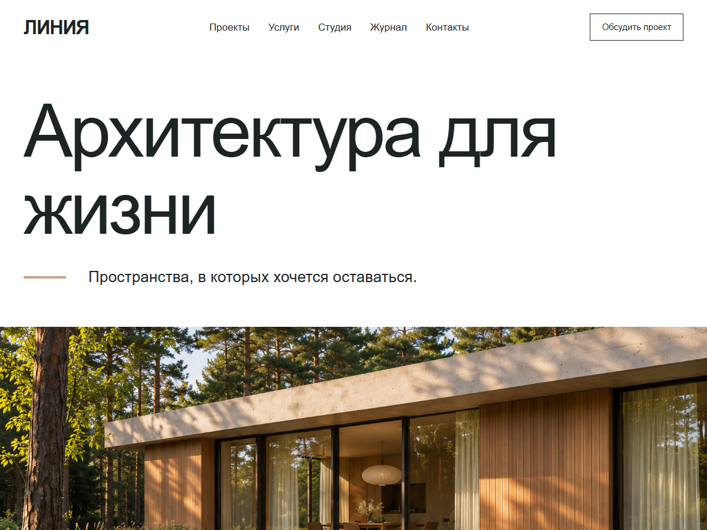

# Линия — сайт на WordPress

Проекты архитектурного бюро, услуги, журнал и демонстрационная форма обращения.

**[Открыть демо](https://linea.komaroff-dev.ru/)**



## Что хранится в репозитории

Docker Compose, начальное развёртывание и настройки учебного сайта. [Тема](https://github.com/komaroffsergei/wordpress-theme-linea) и [плагин](https://github.com/komaroffsergei/wordpress-demo-content) подключены отдельными Git-подмодулями и закреплены по коммитам. Контент создаётся из тестового наполнения, а не восстанавливается из чужой базы.

## Запуск новой демоустановки

Нужны Git, Python 3 и Docker с Compose. На Windows предварительно запустите Docker Desktop.

```sh
git clone --recurse-submodules https://github.com/komaroffsergei/linea-wordpress-site.git
cd linea-wordpress-site
python bootstrap.py
```

Локальный адрес: `http://localhost:8080`. Скрипт создаёт отдельные пароли в локальном `.env`, устанавливает WordPress, тему, плагин и тестовый контент.  Повторный запуск не перезаписывает завершённый импорт.

Админка: `/wp-admin/`, логин `portfolio_admin`, пароль — поле `ADMIN_PASSWORD` в локальном `.env`. Для другого адреса задайте `SITE_URL` до первого запуска. Для публикации наружу нужен собственный HTTPS-прокси; пример Compose привязывает порт только к локальному интерфейсу.

## Редактирование

Проекты и услуги — в соответствующих разделах WordPress; заголовки и главное изображение — в настройщике. Страницы и меню меняются в WordPress без конструктора.

## Границы демо и проверка

Авторский проект Сергея Комарова. Объекты, персонажи и товары вымышлены; изображения сгенерированы для проекта. Платежи, реальная доставка и внешние письма отключены. Используйте тестовые данные.

Последняя браузерная проверка опубликованного сайта: 5 ноября 2026 года. HTTPS, страницы, формы, навигация и ширины 1440/768/390 проверены; см. [снимок результатов](docs/verification.json). Локальный bootstrap — отдельный способ воспроизведения этого демо.

GPL-2.0-or-later; см. LICENSE.txt. Код и права на сторонние компоненты определяются их лицензиями.
